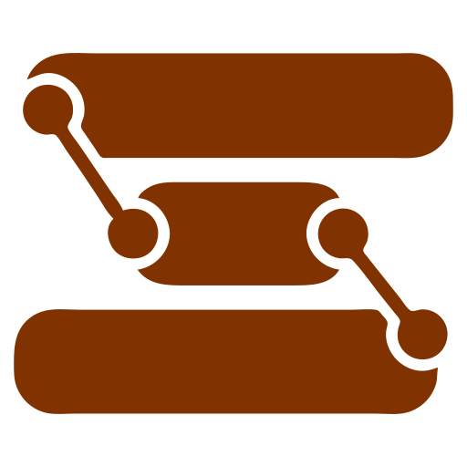
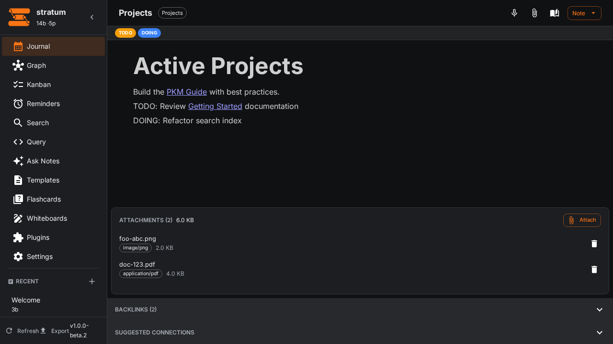
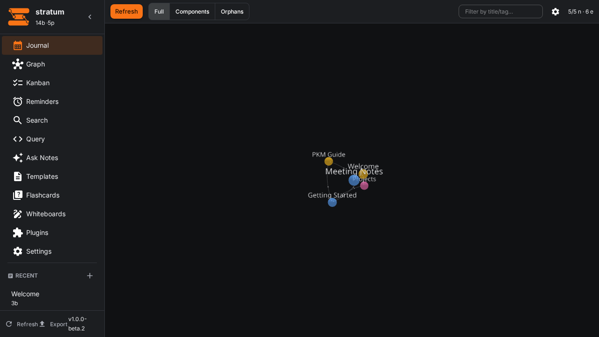
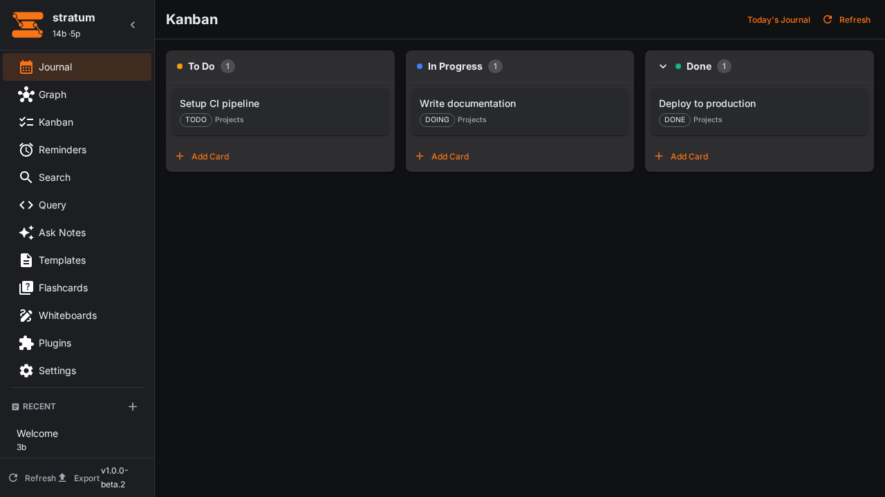
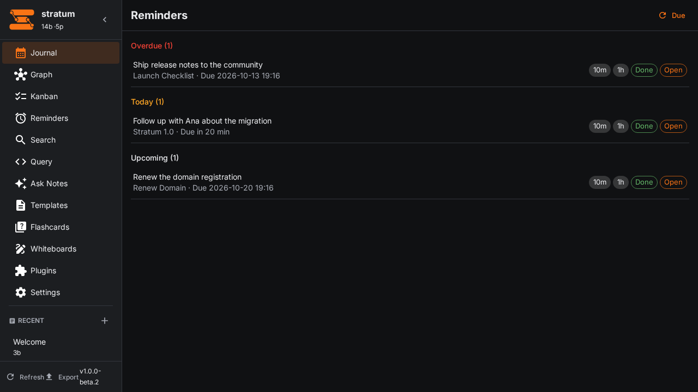
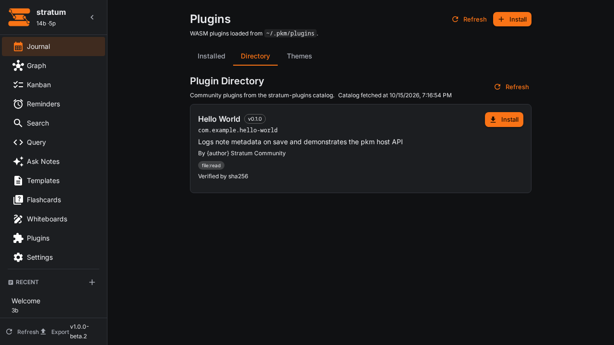
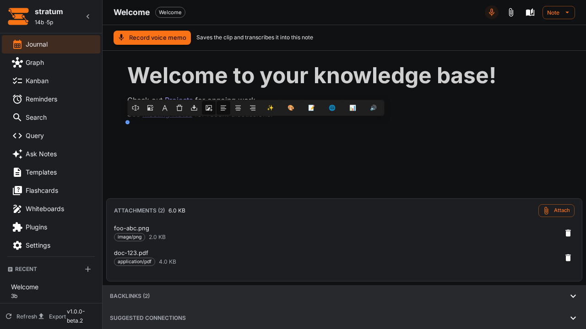
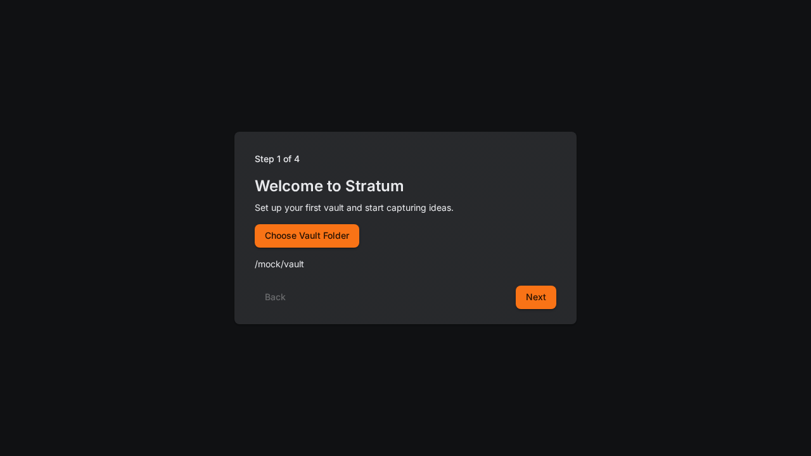
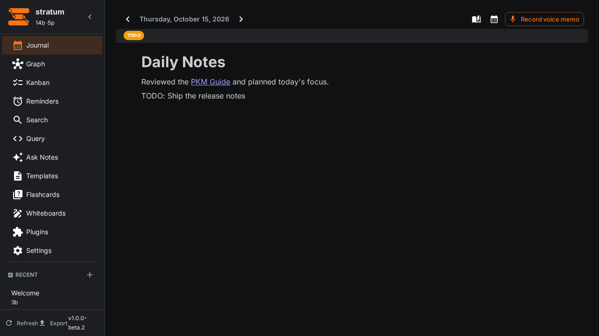

# Stratum

<p align="center">
  
</p>

<p align="center">
  <strong>Your second brain. No strings attached.</strong>
</p>

<p align="center">
  <a href="https://ko-fi.com/S8Y722P093"></a>
  <a href="https://github.com/short-circuit/stratum/actions/workflows/ci.yml"></a>
  <a href="https://github.com/short-circuit/stratum/actions/workflows/docs.yml"></a>
  <a href="LICENSE"></a>
  <a href="https://short-circuit.github.io/stratum/docs/"></a>
</p>

---

Stratum is a **privacy-first, offline-capable personal knowledge management
system** built on one promise: **your notes are plain Markdown files that belong
to you**. There is no proprietary database, no cloud subscription, and no vendor
that can disappear with your knowledge. Everything runs locally, and whenever
you want, you can open any note in any text editor and walk away.

Think Logseq's block outliner meets Obsidian's graph view, built on a Rust
engine that stays fast even with 10,000+ notes.

---

## Why Stratum?

- **Plain Markdown files** — every note is a `.md` file on disk. If Stratum
  disappeared tomorrow, you'd lose nothing. Open any note in any editor, or sync
  it with your own tools.
- **Fully offline** — no cloud dependency. Every feature works without internet;
  AI is bring-your-own (Ollama or any OpenAI-compatible endpoint).
- **Local-first & Git-native** — version history is built into your vault via
  Git. Push to your own remote, or use the built-in WebDAV/folder backup.
- **Extensible** — WASM plugin runtime, a themed ecosystem, and a Datalog query
  engine you can script against. No lock-in, no walled garden.

Stratum's source is **AGPL-3.0-only** — free as in freedom. See
[LICENSE](LICENSE).

---

## Features

### 🧱 Block Outliner

Every paragraph is an addressable block with a UUID. Indent, outdent, drag,
collapse, and reorder — Logseq-style, powered by BlockNote and a Rust core.
Blocks support **markers** (`TODO`/`DOING`/`DONE`), **priorities**, task
properties, and **block references** (`((block-ref))`). A **Prose View (Read
Mode)** renders any page as clean, read-only prose — no editor chrome — while
wiki-links and tags stay clickable. Toggling back to Edit never modifies the
file.

### 🔗 Wiki-Links & Backlinks

`[[Wiki-Link]]` with autocomplete, a backlinks panel with linked references and
unlinked mentions, Ctrl+hover snippet previews, and Ctrl+click navigation.
Block-level embeddings (`{{embed}}`) and inline `#tags` work everywhere.

### 💬 Localization (i18n)

The interface is available in **English, German, Italian, French, and Spanish**
(fully translated), with **Chinese, Japanese, and Greek** placeholders. A CI
gate blocks hardcoded UI strings and enforces locale key parity.

### 📅 Daily Journal & Quick Capture

Auto-created daily notes, a calendar view, one-tap **voice capture** into
today's journal (mobile FAB / desktop button), and a system-tray **Quick
Capture** dialog with a global shortcut — capture from anywhere, no window
required.

### 🕸️ Knowledge Graph

Interactive 2D/3D force-directed graph of your `[[wiki-links]]`, connected
components, orphan detection, tag nodes, search filters, and click-to-navigate.

### 🔍 Full-Text Search

Tantivy-powered, sub-100ms search at 10k+ notes. Tag search with `#tagname`,
autocomplete, and ranked results.

### 📊 Datalog Queries

Query your knowledge base like a database with Datalog — the visual filter
builder, raw EDN/JSON syntax, `:find`/`:where`/`:pull`, block attributes, and
saved queries you can reuse.

### 📋 Templates & Onboarding

A first-run onboarding wizard walks you through vault setup, optional starter
templates (daily note, meeting notes, reading list, project tracker), and a
sample vault. Reusable templates with variable substitution, applied from the
Templates panel.

### 📥 One-Click Importers

Import from **Obsidian**, **Logseq**, or a generic **Markdown** folder with
preview, duplicate detection, and conflict-safe (never destructive) behavior.
Files land under `imported/<source>/` — fully idempotent.

### 📎 Attachments

Inline image embedding, vault `assets/` reference management, attach/upload
with compression, deterministic naming, and deduplication — all stored as plain
files.

### 🃏 Flashcards & Reminders

Spaced-repetition flashcards (SM-2) from `question::`/`answer::` blocks.
Block-level **reminders** with due dates, in-app and OS notifications, snooze,
and a reminders panel (Overdue / Today / Upcoming).

### 📋 Kanban Boards

Drag-and-drop kanban boards from task blocks with markers, priorities, custom
columns, and collapse — right inside your notes.

### 🎨 Whiteboards & Math & Diagrams

Excalidraw spatial canvases, KaTeX inline and display equations with a symbol
palette, and Mermaid diagrams (flowcharts, sequence, Gantt, and more) rendered
inline.

### 🤖 AI Assistant (Bring Your Own LLM)

Rewrite, summarize, structure, and interlink notes with an AI slash menu and
formatting toolbar. **RAG chat — "Ask your notes"** with embeddings, and
**Text-to-Speech** read-aloud. Works with **Ollama** or any OpenAI-compatible
endpoint, including automatic **local endpoint discovery**. Multi-depth
**web research** via SearXNG.

### 🗣️ Voice Dictation

Full dictation pipeline: record, transcribe (choose the backend — whisper.cpp,
OpenAI-compatible, LocalAI), diarize, summarize, and structure into notes —
with punctuation and speaker labels.

### 🔄 Git Sync & Backup

Manual sync, auto-commit, auto-sync, or background daemon. Native Git (git2) —
push to your own remote, plus a **WebDAV/folder backup** mirror with
test-connection and run-now status. No cloud vendor in the middle.

### 📄 Export: HTML / JSON / PDF / ZIP

Per-page **HTML** and **JSON**, per-page **PDF** via headless Chromium (MathML +
Mermaid), and a portable **vault ZIP** with manifest — plain data out the door.

### 🔌 Plugin Directory & Themes

A WASM plugin runtime with note read/write and HTTP host functions. Browse and
install from the in-app **Plugin Directory** and **Theme Hub** (backed by the
`stratum-plugins` catalog with sha256 verification).

### 🧩 MCP Server

Expose your vault to external AI clients over the Model Context Protocol — stdio
or Streamable HTTP, with PAT auth, scopes, and rate limiting in pkm-mcp-security.

### ⌨️ Full CLI & MCP

A full terminal interface — init, list, search, stats, graph, sync, export —
plus the MCP server for programmatic access.

---

## Screenshots

The app, in real shipped state (v1.0.0-beta.3).

<p align="center">
  
  <br><em>Block outliner editor with wiki-links, tasks, and attachments.</em>
</p>

<p align="center">
  
  <br><em>Knowledge graph with connected components and orphan detection.</em>
</p>

<p align="center">
  
  <br><em>Kanban board built from task blocks.</em>
</p>

<p align="center">
  
  <br><em>Reminders panel with overdue, today, and upcoming sections.</em>
</p>

<p align="center">
  
  <br><em>Plugin directory with installable community plugins.</em>
</p>

<p align="center">
  
  <br><em>Voice dictation panel.</em>
</p>

<p align="center">
  
  <br><em>First-run onboarding wizard.</em>
</p>

<p align="center">
  
  <br><em>Daily journal.</em>
</p>

---

## How Stratum compares

Stratum's angle is **privacy-first, local-first, and portable** — no proprietary
database, no mandatory cloud. The trade-off is that you own the sync setup.

| | **Stratum** | Obsidian | Logseq | Notion |
|---|---|---|---|---|
| Notes are plain Markdown on disk | ✅ | ✅ (`.md` files) | ✅ (`.md` files) | ❌ (proprietary DB) |
| Works fully offline | ✅ | ✅ | ✅ | ⚠️ (heavily cloud-dependent) |
| No account required to use | ✅ | ✅ | ✅ | ❌ (account required) |
| Built-in Git sync (push to your own remote) | ✅ | ⚠️ (via community plugins) | ✅ | ❌ |
| Block-level outliner (every paragraph addressable) | ✅ | ⚠️ (blocks in plugins) | ✅ | ✅ |
| Native Datalog query engine | ✅ | ❌ | ⚠️ (queries, not Datalog) | ❌ |
| Local AI (bring your own LLM, no cloud key) | ✅ | ⚠️ (plugin/paid) | ⚠️ (plugin) | ✅ (cloud AI) |
| In-app plugin directory + theme hub | ✅ | ⚠️ (registry, no in-app hub) | ⚠️ | ❌ |
| Importer for Obsidian / Logseq / Markdown | ✅ | — | — | ⚠️ (via tools) |
| Open source (AGPL-3.0) | ✅ | ❌ | ✅ | ❌ |
| Price | Free, no account | Free (sync paid) | Free (sync paid) | Free tier, cloud-required |

Stratum intentionally trades a hosted sync service for **your own infra**: your
notes, your Git remote, your backups. See the [Git Sync
guide](docs/guide/git-sync.md) for syncing to your own remote and the built-in
WebDAV/folder backup mirror.

---

## Installation

### Download a Release (recommended)

Pre-built binaries for Linux, Windows, macOS, and Android are available on the
[GitHub Releases page](https://github.com/short-circuit/stratum/releases). Every
release ships a `sha256sums.txt` with checksums for all artifacts.

| Platform | Format | File |
|----------|--------|------|
| Linux | AppImage | `stratum-pkm-linux.AppImage` |
| Linux | Debian | `stratum-pkm-linux.deb` |
| Linux | RPM | `stratum-pkm-linux.rpm` |
| Windows | Portable exe | `stratum-pkm-windows.exe` |
| macOS | App bundle | `stratum-pkm-macos.zip` |
| Android | APK / AAB | `stratum-pkm-android.apk` / `stratum-pkm-android.aab` |

### Build from Source

Requires **Rust 1.75+**, **Node.js 22+**, and Tauri v2 system libraries (see the
[Installation guide](docs/getting-started/installation.md)).

```bash
# Nix (recommended — all dependencies included)
nix develop ./nix

# Or build manually
cargo build --workspace
npm install
npm run tauri:dev
```

For the full quick-start, see [docs/getting-started/quickstart.md](docs/getting-started/quickstart.md).

---

## Roadmap

Stratum is in active development — v1.0.0-beta.3. See the
[documentation home](https://short-circuit.github.io/stratum/docs/) for every
feature guide (block editor, linking, graph, Datalog, sync, MCP server, and
more). The docs are also mirrored in this repository under
[`docs/`](docs/index.md).

## Get Involved

Contributions welcome — bug reports, translations, docs, and code. Before
your first PR, read the
[CONTRIBUTING guide](https://short-circuit.github.io/stratum/docs/contributing/):
fork → branch off `master` with a Conventional Commit `feat(scope): …`,
verify with `cargo test --workspace` + `npm run test && npm run lint`, follow
the documentation rules, and submit a pull request. Good first issues are
labelled [good first issue](https://github.com/short-circuit/stratum/labels/good%20first%20issue).
WASM plugins go to the [stratum-plugins](https://github.com/short-circuit/stratum-plugins)
repository (`PLUGIN_TEMPLATE.md`).

## License

AGPL-3.0-only — see [LICENSE](LICENSE).
